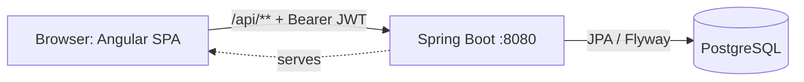
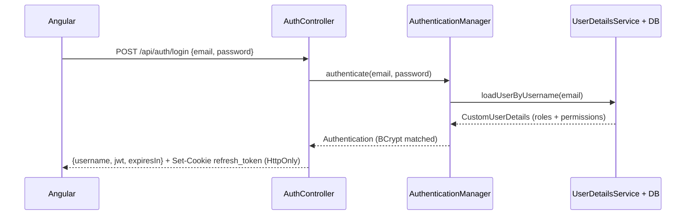
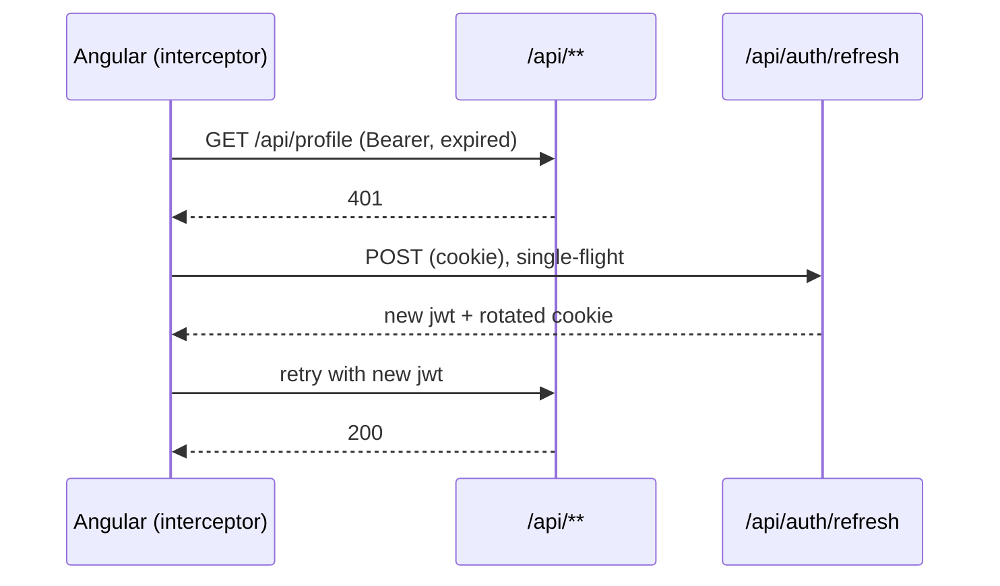
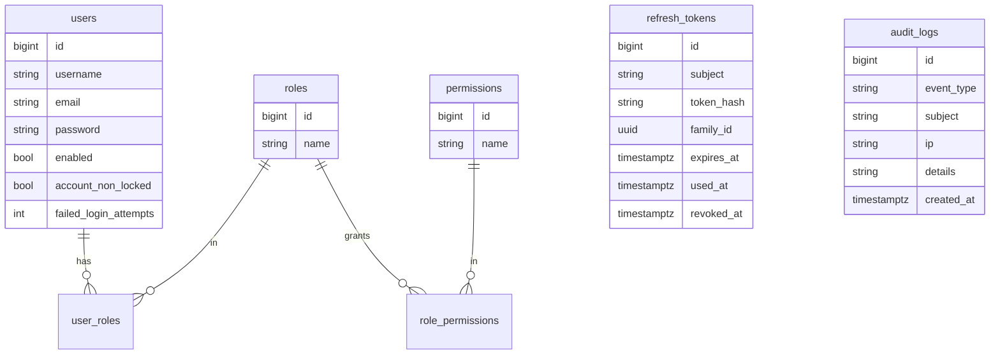

# secure-starter

Reusable full-stack security starter: **Spring Boot (Java 25) + Angular 21 + PostgreSQL**.
JWT authentication, refresh-token rotation and RBAC are built by hand on Spring Security,
so every step of the flow is visible. Clone it as the base for new projects.

## Architecture

Modular monolith (Spring Modulith: `auth`, `user`, `core`), one deployable jar.
Angular is built into `static/` and served by Spring on the same origin: no CORS,
and the refresh cookie can be `SameSite=Strict`.



| Mode | How it runs |
|---|---|
| Dev | `ng serve` on :4200, proxy `/api` to :8080 |
| Prod | Maven/Docker builds Angular into the jar; Spring serves it on :8080 |

## Authentication flow



Failures return a generic 401 ("Invalid email or password"). Failed attempts are
counted and lock the account after `app.security.max-failed-login-attempts` (default 5).
Login and register are rate-limited per IP.

## JWT and refresh flow

- **Access token:** HS256, 15 minutes. `sub` = email; claims `email`, `username`, `role`
  (authorities). Kept in memory only (an Angular signal).
  The server reloads the user from the DB on every request, so decoded claims
  in the browser are display-only.
- **Refresh token:** opaque 32-byte random value, stored as a SHA-256 hash in `refresh_tokens`.
  Sent as an `HttpOnly; SameSite=Strict; Path=/api/auth` cookie.
- **Rotation:** each `/refresh` marks the old token used and issues a new one in the same family.
- **Reuse detection:** presenting a used token revokes the whole family.
- Disabled, locked or deleted users cannot refresh; password change and user
  deactivation revoke all of that user's tokens.



## Authorization flow

- Roles are `ROLE_X`, permissions are plain (`USER_READ`, `USER_DELETE`, ...).
- `/api/public/**`, `/api/auth/**` open; `/api/admin/**` needs `ROLE_ADMIN`; other `/api/**` authenticated.
- Fine-grained checks via `@PreAuthorize("hasAuthority('USER_DELETE')")`.
- 401 and 403 responses are JSON; `ACCESS_DENIED` is written to `audit_logs`.
- Angular guards (`authGuard`, `roleGuard`, `permissionGuard`) are UX only.
  The backend rejects every unauthorized call on its own.

## Spring Security filter chain

Chain 0 matches Swagger/OpenAPI paths and permits them. Chain 1 handles the rest, stateless with CSRF off (bearer tokens):

```
Request
  -> AuthRateLimitFilter (POST /api/auth/**)
  -> JwtAuthenticationFilter  (Bearer -> validate -> SecurityContext)
  -> UsernamePasswordAuthenticationFilter (unused)
  -> authorizeHttpRequests -> @PreAuthorize -> Controller
  401: CustomAuthenticationEntryPoint   403: CustomAccessDeniedHandler
```

Security headers: CSP, X-Frame-Options DENY, Referrer-Policy, Permissions-Policy.

## Database model



`refresh_tokens.subject` is the user's email (no FK), which keeps the `auth` module independent of `user` internals.
Seeded by Flyway: `ROLE_USER` (`USER_READ`, `PROFILE_READ`), `ROLE_ADMIN` (all permissions).

## Angular authentication

- `AuthService`: signals for token/user/roles/permissions; `login`, `register`, `refresh`
  (shared in-flight request), `restoreSession`, `logout`.
- `provideAppInitializer(restoreSession)` silently refreshes on load, so guards see the right state.
- `authInterceptor`: adds the Bearer header to `/api/**` (not `/api/auth/**`), on 401 refreshes once and
  retries, on 403 navigates to `/forbidden`.
- Routes: `/login`, `/register`, `/dashboard`, `/profile`, `/admin/users` (`ROLE_ADMIN` + `USER_READ`), `/forbidden`.

## Running locally

Prerequisites: JDK 25, Node 22, Docker.

```bash
docker compose up -d postgres            # DB on localhost:5486
export JWT_SECRET=$(openssl rand -base64 32)
export DEV_ADMIN_PASSWORD='use-a-local-password'
# application.yaml points at :5432; override for the compose DB:
export SPRING_DATASOURCE_URL='jdbc:postgresql://localhost:5486/secure_starter_db?options=-c%20TimeZone=UTC'
mvn spring-boot:run -Dspring-boot.run.profiles=dev     # API on :8080
cd angular && npm ci && ng serve                        # UI on :4200 (proxy -> :8080)
```

Backend only: `mvn package -DskipFrontend`. Tests: `mvn test` (PostgreSQL migration test needs Docker).

## Docker

```bash
cp .env.example .env     # then edit the three values
docker compose up --build
```

App: http://localhost:8080 | Health: `/actuator/health` | API docs: `/swagger-ui.html`.
The compose file uses the `dev` profile (seeded admin, non-Secure cookie) for local demos only.
In production, use TLS, drop `dev`, and keep the frontend on the same origin.

## Test users

| User | Credentials | Roles |
|---|---|---|
| Admin (seeded in `dev`) | `admin@example.com` / `DEV_ADMIN_PASSWORD` | `ROLE_ADMIN`, all permissions |
| Normal user | register at `/register` | `ROLE_USER` |

Proof that guards are not security:

```bash
curl -i -X DELETE http://localhost:8080/api/users/5 -H "Authorization: Bearer <USER_TOKEN>"   # 403
```